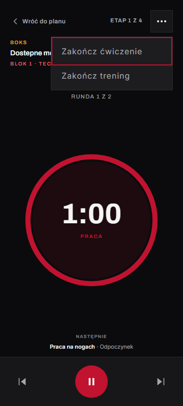
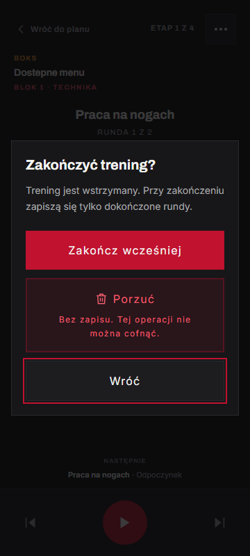
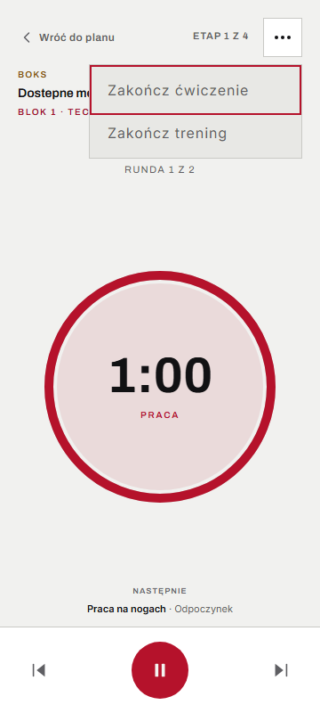
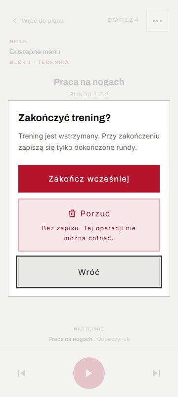

# Issue #36 — menu i bezpieczne wyjście z odtwarzacza

## 1. Werdykt

**PASS z uwagami** — zakres issue #36 został wykonany. Uwagi dotyczą istniejących ostrzeżeń narzędzi; nie ma znanych problemów P1/P2 w tej zmianie.

- Repozytorium: `AntoniKra/Martial-Arts-App`.
- Gałąź: `feat/player-exit-menu`.
- Baza: `7a354324287e342988653e3698cdc5036fc390c6`, scalony PR #37.
- Przed rozpoczęciem: czyste drzewo, `git switch main` i `git pull --ff-only` zakończone poprawnie; `main` aktualny.

## 2. Zmiany

- `src/features/workout-player/components/WorkoutPlayerExitControls.tsx`: menu z przyciskiem 44×44 px, obsługą klawiatury i oknem wyjścia. `useBlocker` chroni nawigację aplikacji, w tym link do planu i przeglądarkowe „wstecz”. Każda zablokowana nawigacja jest obsługiwana raz, żeby anulowanie jej nie otwierało ponownie okna.
- `src/features/workout-player/hooks/useWorkoutPlayback.ts` i `utils/finishPlaybackSteps.ts`: zakończenie całego ćwiczenia przechodzi do kolejnego elementu planu; bieżąca i pozostałe rundy są pomijane bez czasu pracy. Wcześniejsze wyniki i czas rzeczywiście wykonanych prób pozostają zachowane. Wcześniejsze zakończenie uzupełnia wyniki wszystkich pozostałych etapów zerowymi pominięciami.
- `src/features/workout-player/hooks/useWorkoutSessionRecorder.ts` i `types/workoutPlaybackEvents.types.ts`: przekazanie `endedEarly: true` do `createPlanWorkoutSession`, zapis `partial` tylko po dokończeniu co najmniej jednego etapu ćwiczenia; zachowany komunikat o braku pracy.
- `src/features/workout-player/components/WorkoutPlayerView.tsx`: ekran „Trening zakończony wcześniej”, dotychczasowy zapis, ponowienie i restart.
- `src/features/workout-player/workoutPlayerLabels.ts`: jeden moduł nowych tekstów odtwarzacza i etykiet statusu.
- Karty, mapowania i typy w `src/features/home/` oraz `src/features/workouts/`: tekstowy status „Ukończony” / „Częściowy” w obu widokach historii.
- Testy: `e2e/playerExit.spec.ts`, `utils/finishPlaybackSteps.test.ts` i testy mapowania historii.

Otwarcie okna pauzuje stoper. „Wróć” i Escape przywracają poprzedni stan: trwający trening jest wznawiany, a wcześniej zapauzowany pozostaje zapauzowany. Fokus zaczyna na „Wróć”, Tab/Shift+Tab pozostają w oknie, po zamknięciu fokus wraca na przycisk menu. „Porzuć” ma ikonę, obramowanie i jawny opis nieodwracalności, ponieważ sam kolor nie wystarcza do przekazania skutku tej operacji.

Odstępstwa od specyfikacji: **brak**. Bez nowych zależności i bez zmian poza `combat-training-app/`.

## 3. Weryfikacja

- `npm run typecheck`: PASS, kod 0.
- `npm run lint`: PASS, kod 0; 0 błędów, 21 istniejących ostrzeżeń.
- `npm test`: **342 pass / 0 fail / 0 skip**, 29 plików.
- `npm run build`: PASS, kod 0; wygenerowany build i service worker.
- Testy celowane E2E odtwarzacza: **39 pass / 0 fail / 0 skip**.
- `npm run test:e2e`: **147 pass / 0 fail / 0 skip**, Chromium, 360×800, 768×1024 i 1440×900. W tym 39 przypadków z pliku odtwarzacza (13 scenariuszy na każdej rozdzielczości).
- axe: nowe menu i okno w obu motywach na trzech rozdzielczościach bez naruszeń od poziomu `moderate`.
- Ręcznie obejrzano cztery zrzuty telefonu poniżej.
- `git diff --check`: PASS. Końcowy status, statystyka zmian, commit i SHA-256 pełnego diffu względem bazy są podane w raporcie końcowym czatu.

E2E sprawdzają zapis częściowy po ukończonej rundzie, brak zapisu podczas pierwszej rundy, porzucenie po wykonanej pracy, oba stany powrotu z okna, ponawiane przeglądarkowe „wstecz”, wyjście bez pytania przed startem i po końcu, oba statusy historii na liście i stronie głównej, pominięcie całego ćwiczenia, błąd i ponowienie zapisu oraz restart.

Dowód czasu: zakończenie po 60 s pracy, 30 s odpoczynku i 5 s przerwanej rundy zapisuje `durationSeconds: 95`, `workSeconds: 60`, mimo dodatkowych 120 s w oknie. Wyniki zawierają cały plan, a realizacja wynosi 0/2 ćwiczeń, ponieważ pierwsze ćwiczenie miało dwie rundy.

Podczas implementacji wykryto i poprawiono dwa błędy: ponowne otwieranie okna po anulowaniu zablokowanej nawigacji oraz brak zawijania fokusu na krańcach okna. Początkowy przebieg celowany po pierwszej poprawce miał 27 pass / 6 fail; sześć błędów dotyczyło klawiatury w obu motywach na trzech rozdzielczościach. Zostały naprawione, bez osłabiania asercji. W pierwszej próbie analiza axe zatrzymała się na zamrożonym zegarze testowym; test dostępności korzysta teraz z działającego zegara, a testy czasu nadal z kontrolowanego. Nie stwierdzono flaky testów w końcowych przebiegach.

### Poprawki po przeglądzie Claude w PR #38

Punkt startowy poprawek: czysta gałąź `feat/player-exit-menu`, commit `8812f28f1d0ae8efd0fc808209ee69923cccef83`.

- `WorkoutPlayerExitControls.tsx`: „Porzuć” przy `blocker.state === 'blocked'` wywołuje `blocker.proceed()`, bez `reset()` i bez tworzenia nowej nawigacji do planu. Dzięki temu zachowuje cel rozpoczętej nawigacji oraz pozycję w historii przeglądarki. Tylko porzucenie z menu „Zakończ trening” korzysta z `navigate(workoutDetailsPath)`.
- `workoutPlayerLabels.ts`: opis okna brzmi dokładnie „Trening jest wstrzymany. Przy zakończeniu zapiszą się tylko dokończone rundy.”
- `e2e/playerExit.spec.ts`: dodano regresję „wstecz → Porzuć → poprzednia strona → ponowne wstecz → lista treningów”, bez powrotu do odtwarzacza i bez zapisu. Osobny test chroni powrót do planu po porzuceniu z menu. Opis okna jest również sprawdzany jako jego dostępny opis.
- Odświeżono cztery zrzuty w `docs/reviews/issue-36/`, w tym okno z nowym tekstem w obu motywach.
- Ponownie uruchomiono pełne Definition of done oraz celowane i pełne E2E; aktualne wyniki są podane powyżej. Zakres poprawek zgodny z poleceniem, bez odstępstw.

## 4. Problemy i ryzyka

- P1/P2: brak znanych problemów.
- P3: istniejące ostrzeżenia ESLint (21), ostrzeżenie Vite o konfiguracji przyszłego loadera i rozmiarze pakietu Firebase. Nie zmieniano konfiguracji ani reguł, bo nie należą do zakresu issue #36.
- Zakres testów urządzeń: Chromium na trzech rozdzielczościach. Nie wykonywano testu na fizycznym telefonie z Androidem; przeglądarkowe „wstecz” jest objęte E2E i wspólnym mechanizmem `useBlocker`.

## 5. Potwierdzenie ograniczeń

Commit i push wyłącznie na wskazaną gałąź, zgodnie z jawną zgodą użytkownika; bez scalania. Bez wdrożenia, połączeń z produkcją, zmian Firestore, odczytu plików sekretów, wywołań płatnych API i zmian w referencji Figmy. Testy logowania używały wyłącznie lokalnego emulatora z projektem `demo-combat-training`. Raport i obrazy znajdują się w tym repozytorium; logi robocze w systemowym folderze tymczasowym.

## Zrzuty: telefon 360×800

Menu, ciemny motyw:

Okno wyjścia, ciemny motyw:

Menu, jasny motyw:

Okno wyjścia, jasny motyw:

